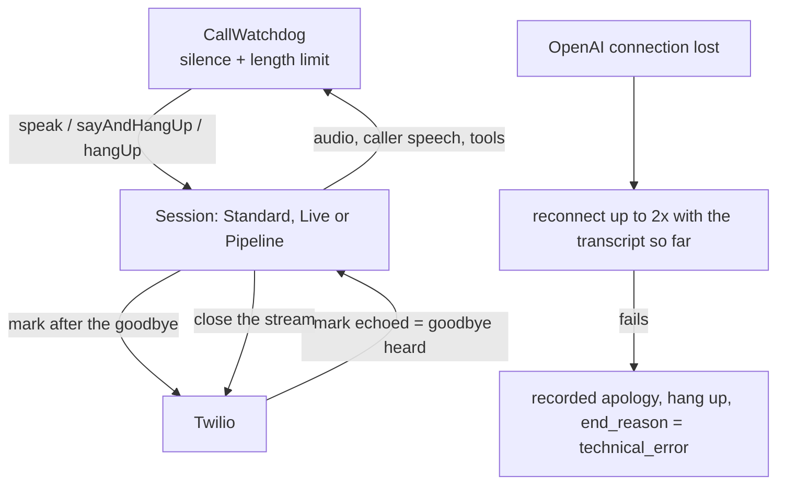

# Ending a call: goodbye, silence, length limit, lost connection

## 1. What it is and why it exists

A call must always end properly. Before this work the line was often left open: `end_call` was an optional capability (off by default), and the Standard, Live and Pipeline sessions each closed the call in their own way. This feature gives all three the same behaviour and adds a watch over silence, call length and a lost connection to OpenAI. Linear: LEA-158 (end call), LEA-160 (silence, limit, fallback). The dashboard half (settings, warning symbol) is in `flowvoice/docs/features/call-ending.md`.

## 2. How it works

1. **Normal ending.** The assistant says goodbye and calls `end_call` in the same turn. The session sends a Twilio "mark" after the goodbye audio; Twilio echoes it when the audio has been played; only then the stream is closed and the summary is written (`end()` runs at that moment, not before). If the caller speaks again more than 1.5 s after `end_call` (`RESUME_GRACE_MS`), the hang-up is taken back and the call goes on. If Twilio never echoes the mark, the line is closed after 15 s (`END_CALL_MARK_FALLBACK_MS`).
2. **`end_call` without a goodbye.** The model sometimes calls `end_call` without saying anything (seen in a simulated call on 2026-11-03). If the answer had no words or sound, the engine says the goodbye sentence itself (`call.goodbye_*`) and hangs up after it (Standard, Hybrid, Pipeline; in Live the voice always says it).
3. **Safety net for a forgotten `end_call`.** (a) If the assistant's last words contain a goodbye (`containsGoodbye`) and the caller is silent for 6 s, the engine hangs up without a further question. (b) Pipeline only (LEA-174): after every answer without a tool call, a second small model call (same model and effort as the brain, prompt `engine.call.end_check`, input only the last six lines, answer `END` or `CONTINUE`, 8 s timeout) runs while the answer is spoken. On `END` the engine hangs up like after `end_call` (the caller speaking again takes it back). Cost: a few hundred input tokens per answer, counted in the call's LLM usage. A failed check is ignored (the call goes on). Seen on 2026-11-04: the model said "Na shledanou" three times without calling `end_call`.
4. **Silence.** (Pipeline, LEA-175: the two sentences below are said by the model from a hint, the recorded text is the fallback.) 6 s after the assistant stops speaking (`SILENCE_ASK_MS`) it says the "Are you still there?" sentence; after 6 s more (`SILENCE_HANGUP_MS`) it says the goodbye sentence and hangs up. Not counted while the assistant speaks, a tool runs, the model is answering, or the connection is being re-made.
   **Pipeline is quiet (LEA-181):** no spoken question and no spoken goodbye for silence. The watchdog runs in quiet mode (`CallWatchdog` option `silent`): after `assistant_settings.silence_hangup_seconds` of silence (default 30, 10 to 120, `silenceHangupMs`; Assistant → Advanced settings, shown only for the Pipeline engine) the call ends without a word (`end_reason = silence`); after a goodbye of the assistant the wait is 6 s. Silence is never counted while the caller talks or the transcript is on its way (`callerSoundStarted`, `callerSoundStopped`, `transcriptDone`: 30 s cap after the sound starts, 10 s wait after it stops), nor while an answer is made or a tool runs; the timer re-checks this when it fires. Cause of the old misfires: the count was reset only after 1 s of verified sound or a transcript, so a sentence started late in the 6 s, or one longer than about 7 s, was followed by "Are you still there?" before its transcript arrived.
5. **Length limit.** `assistant_settings.max_call_minutes` (default 10, clamped to 2 to 30 by `maxCallMs`). One minute before the end (`LIMIT_WARNING_BEFORE_MS`) the assistant warns the caller; at the limit it says goodbye and hangs up. It applies to phone calls and to test calls alike (LEA-174: before, a test call ran without this limit and so showed behaviour a real call would not have). A test call also keeps the overall cap from its ticket (`handlers/browser.ts`); whichever comes first ends the call.
   **Pipeline (LEA-181):** no warning one minute before; at the limit a caller who is talking (or whose answer is being made) is let finish, and the goodbye comes when the line is calm, at the latest `LIMIT_GRACE_MS` (30 s) after the limit.
6. **Lost connection to OpenAI (Standard, Hybrid, Live).** A recorded "one moment" sentence is played at once. The engine opens a new connection (`MAX_RECONNECTS` = 2, 6 s each); the new session gets the same settings plus the transcript so far in its instructions ("CALL IN PROGRESS: do not greet again") and the caller's audio that arrived meanwhile (up to 1.5 s, `InputBuffer`). On success the assistant says the "sorry about the short interruption" sentence and carries on. If both attempts fail, a recorded apology is played, the call is hung up, `calls.end_reason = 'technical_error'` and `calls.status = 'follow-up'` are written, and the owner's SMS/e-mail (when the owner has them on) carries a warning line and is sent even for a very short call.
7. **Pipeline.** Speech-recognition drops were already handled (one reconnect, then apology). New: if the language model fails twice in a row, or fails after one retry, the same apology and hang-up apply.

## 3. Where it lives

- `src/call-ending.ts`: constants, `CallWatchdog`, `maxCallMs`, `endCallEnabled`, `containsGoodbye`, `fixedTexts`, `withTechnicalNotice`.
- `src/session.ts` (Standard + Hybrid), `src/live-session.ts` (Live), `src/pipeline-session.ts` (Pipeline): each implements `speakFixed`, `sayAndHangUp`, the hang-up with a mark, and (Standard, Live) `recoverConnection`.
- `src/fallback-audio.ts` and `src/fallback-audio-data.ts`: the recorded sentences (μ-law 8 kHz), **one set per assistant voice** (all voices in `VOICE_GENDER`), so the caller hears the voice of the call. Generated by `npm run fallback-audio` (`src/scripts/make-fallback-audio.ts`, needs an OpenAI key, run by hand). **When a voice or a sentence is added or changed, run it again** (`tests/fallback-audio.test.ts` fails until every voice has every sentence; the rule is also in the project's `CLAUDE.md`). Played only on phone calls.
- `src/call-finish.ts`, `src/call-logger.ts` (`saveEndReason`): notifications and the end reason.
- `src/prompts/registry.ts`: all fixed sentences (`call.silence_*`, `call.limit_*`, `call.reconnected_*`), the ending rule (`call.ending_rule`) and the tool texts `end_call` and `end_call_live`. Editable in the admin (Admin → AI Settings); the recorded sentences are not.
- `src/prompt.ts`: `end_call` is offered unless `capabilities.end_call === false`.

## 4. Data

- Reads `assistant_settings.max_call_minutes` and `capabilities.end_call`.
- Writes `calls.end_reason` (`silence`, `time_limit`, `technical_error`; nothing when the caller hung up or said goodbye) and, for `technical_error`, `calls.status = 'follow-up'`. Both writes are separate from the main call write, so an older database without the column does not stop the call from being saved.
- `calls.quality.reconnects` counts re-made connections; event `quality.reconnected`.

## 5. Behaviour and limits

| Rule | Value | Defined in |
|---|---|---|
| Silence before the question / before the goodbye | 6 s / 6 s | `SILENCE_ASK_MS`, `SILENCE_HANGUP_MS` |
| Default call length | 10 min (2 to 30) | `DEFAULT_MAX_CALL_MINUTES`, `MIN_`/`MAX_MAX_CALL_MINUTES` |
| Warning before the limit | 60 s | `LIMIT_WARNING_BEFORE_MS` |
| Caller speech that takes back a hang-up | later than 1.5 s | `RESUME_GRACE_MS` |
| Reconnect attempts | 2, 6 s each | `MAX_RECONNECTS`, `RECONNECT_TIMEOUT_MS` |
| Transcript handed to a new session | last 40 turns | `RESUME_TRANSCRIPT_TURNS` |

- Silence, limit and error endings cannot be taken back by the caller speaking (only an `end_call` can).
- A customer who switches `end_call` off still gets the silence and limit endings.
- A browser test call has no recorded sentences (they are in the phone's format); it has the same length limit as a phone call.

## 6. Dependencies

- Needs the migration `20261107_call_ending.sql` (dashboard repo). Without it the engine uses 10 minutes, treats `end_call` as on and loses only the `end_reason` write.
- Used by the dashboard (warning symbol, settings), the owner notifications, the guided tour (`assistant:end-call-enable`) and the public pages about End call and Advanced settings.

## 7. How to test it

- Automated: `tests/call-ending.test.ts`, `tests/live-session-ending.test.ts`, `tests/standard-session-ending.test.ts`, `tests/pipeline-session.test.ts` (apology and end reason), `tests/prompt.test.ts`.
- Staging: a Test call from the dashboard (browser): stay silent for 6 s and 12 s. The length limit also works in a Test call (set `max_call_minutes` to 2: the warning comes after 1 minute, the goodbye at 2). A phone call is needed only for the recorded sentences.
- Lost connection: `src/scripts/phone-sim.ts` against staging with the OpenAI socket dropped.

## 8. Decisions and known gaps

- The owner decided: the maximum length is a customer setting (default 10 min); reconnect is wanted; forwarding the call to the owner is not.
- `end_call` is on by default but can be switched off ("their usage").
- The goodbye detector is a word list (Czech and English); it only acts together with 6 s of caller silence.
- The recorded sentences are generated with OpenAI text-to-speech (`gpt-4o-mini-tts`) in each voice name; they are not the Realtime model, so a slight difference from the live voice is possible (`TO CONFIRM` by listening).
- Live: whether a new session accepts the conversation as items instead of instructions is not verified; the instructions route is used.

---

**Owner:** Tomáš Marek · **Last verified:** 2026-11-03, branch `tomasmarekcz/lea-158-160-call-ending` · **Issues:** LEA-158, LEA-160
