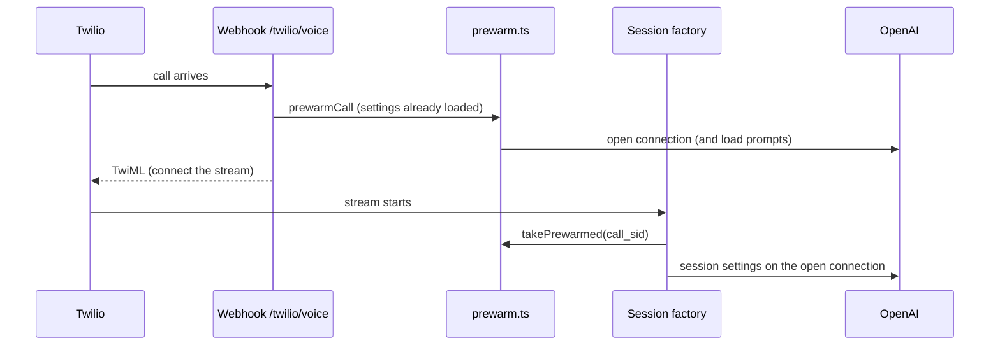

# Faster start of a call: connect to OpenAI when the call is answered

## 1. What it is and why it exists

Measured on staging (2026-11-02): 2.8 s from the start of a call to the assistant's first word: settings about 0.55 s, opening the connection to OpenAI about 1.3 s, session setup and greeting about 0.3 s, first sound about 0.6 s. The caller sat in silence. Linear: LEA-162 (phase A: connection and settings ahead of time; phase B, pre-recording the greeting, is not built).

## 2. How it works

1. The webhook decides "the assistant answers" and calls `prewarmCall({callSid, projectId, settings})` (also after the owner did not answer, in the dial-status step, where it loads the settings itself).
2. `prewarm.ts` loads the prompt snapshot and opens a WebSocket for the engine in the settings: Standard and Hybrid brain (`wss://.../realtime?model=...`), Live (`/v1/live/sessions`). Pipeline has no connection ahead of time.
3. When the stream starts, `createSession` calls `takePrewarmed(callSid)`: it uses the settings and snapshot (no second load) and hands the connection to the session. The session sends its session settings as soon as the connection is open (it may already be). The greeting still starts only when the stream is connected.
4. A connection nobody takes is closed after 10 s (`PREWARM_TTL_MS`); a second webhook for the same call replaces the first.

## 3. Where it lives

`src/prewarm.ts`, `src/handlers/twilio.ts` (two call sites), `src/session-factory.ts` (`takePrewarmed`), `src/session.ts` (`options.socket`), `src/live-session.ts` (`deps.prewarmedSocket`). Environment: `PREWARM=off` switches it off (tests set it).

## 4. Data

Nothing is stored. Log events: `prewarm.used` (engine, `ready_ms_before_stream`), `prewarm.closed` (why), `prewarm.failed`.

## 5. Behaviour and limits

- Any failure means the call starts the old way; nothing here can stop a call.
- Only phone calls (Twilio) use it; browser test calls do not.
- Live: only the first start attempt uses the connection; the retry and the fall-back to Standard open new ones.
- If a Hybrid or Pipeline start fails and Standard answers, the prewarmed connection is not reused (different model).
- Whether OpenAI bills an open connection with no session activity: `TO CONFIRM` (it should not).

## 6. Dependencies

Twilio webhook, session factory, `models.ts` (model names must match what the session would open itself), `prompts/store.ts`.

## 7. How to test it

- Automated: `tests/prewarm.test.ts`, the "connection opened ahead" cases in `tests/standard-session-ending.test.ts` and `tests/live-session-ending.test.ts`.
- Staging: phone-like test call; compare "time to first sound" (Admin → Quality, `first_audio_ms`) before and after; check no `prewarm.closed` with `unclaimed` after normal calls.

## 8. Decisions and known gaps

- Phase A only (owner decision 2026-11-03). Realistic saving: the time between the webhook and the start of the stream plus about 0.55 s of settings loading; the target under 1.5 s may need phase B.

---

**Owner:** Tomáš Marek · **Last verified:** 2026-11-03, branch `tomasmarekcz/lea-157-159-162` · **Issues:** LEA-162
