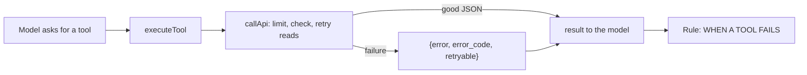

# Tool calls: time limits, answer checks and one error shape

## 1. What it is and why it exists

During a call the assistant uses tools: services, resources, free times, web search, the business knowledge, and writing a booking or an enquiry. Before this work a call to the dashboard had no time limit and its answer was not checked, so a stuck endpoint meant silence in the call and a broken answer could reach the model as if it were true. Linear: LEA-159.

## 2. How it works

1. `executeTool` (`src/tools.ts`) sends every dashboard call through `callApi` (`src/tool-http.ts`).
2. A good answer is passed on unchanged. Any failure becomes `{ error, error_code, retryable }`; the model receives it as the tool result.
3. The prompt block `call.tool_failure_rule` (in every engine) tells the assistant what to say.

## 3. Where it lives

`src/tool-http.ts`, `src/tools.ts`, `src/knowledge.ts` (wrapped by `callWithTimeout`), `src/prompts/registry.ts` (`call.tool_failure_rule`), `src/prompt.ts` (adds it after the tools introduction).

## 4. Data

Nothing is stored. The log line `tool.exec` carries `result_error` and `error_code`; the call quality numbers (`tool_problems`) count a tool whose result has an `error`.

## 5. Behaviour and limits

| Kind | Limit | Repeats | Constant |
|---|---|---|---|
| Reads: services, resources, day availability | 4 s | once more after a timeout, a lost connection or a 5xx | `TOOL_TIMEOUT_MS.read`, `TOOL_READ_RETRIES` |
| Business knowledge search | 5 s | once more | `TOOL_TIMEOUT_MS.knowledge` |
| Web search | 10 s | no | `TOOL_TIMEOUT_MS.webSearch` |
| Writes: booking, enquiry | 8 s | **never** | `TOOL_TIMEOUT_MS.write` |

| `error_code` | Meaning |
|---|---|
| `timeout` | a read did not answer in time |
| `unavailable` | could not connect, or the service answered 5xx |
| `bad_response` | the answer was not readable JSON |
| `rejected` | the service refused (4xx); its own `error` and `message` are passed on (for example `start_time_in_past`) |
| `unknown_outcome` | a write failed after it was sent: it may or may not be saved. The assistant must not confirm it |

- The worst case for a read is two attempts, about 8 s; a write 8 s; web search 10 s.
- There is deliberately no "one moment" sentence while a tool runs in Standard or Hybrid (Pipeline and Live already have their own).
- `get_available_slots` was removed from the engine (the model had not been offered it for a long time). Old calls in the history still show its name.

## 6. Dependencies

Needs the dashboard routes in its `docs/technical.md`; `rejected` bodies must have the shape `{ error, message }`. Used by all engines through `session.ts`, `live-session.ts`, `pipeline-session.ts`.

## 7. How to test it

- Automated: `tests/tool-http.test.ts`, `tests/tools.test.ts`, `tests/tool-logging.test.ts`.
- Staging: stop the dashboard (or make `FRONTEND_API_URL` unreachable), make a Test call and ask for free times. The assistant answers within the limit and says it cannot check right now, offering to take details.

## 8. Decisions and known gaps

- A write is never repeated: a repeated booking could be a double booking. A duplicate-safe key on the server would allow retries; not built (`TO CONFIRM` if wanted).
- Owner decision (2026-11-03): web search 10 s, knowledge one retry, no filler sentence.

---

**Owner:** Tomáš Marek · **Last verified:** 2026-11-03, branch `tomasmarekcz/lea-157-159-162` · **Issues:** LEA-159
